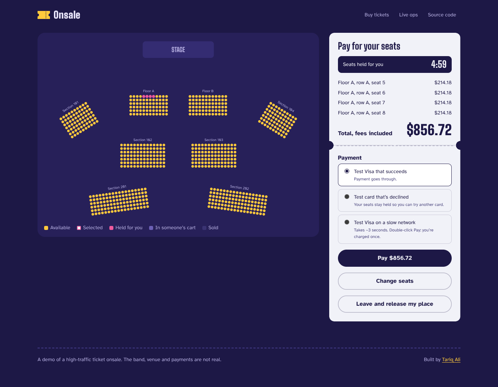
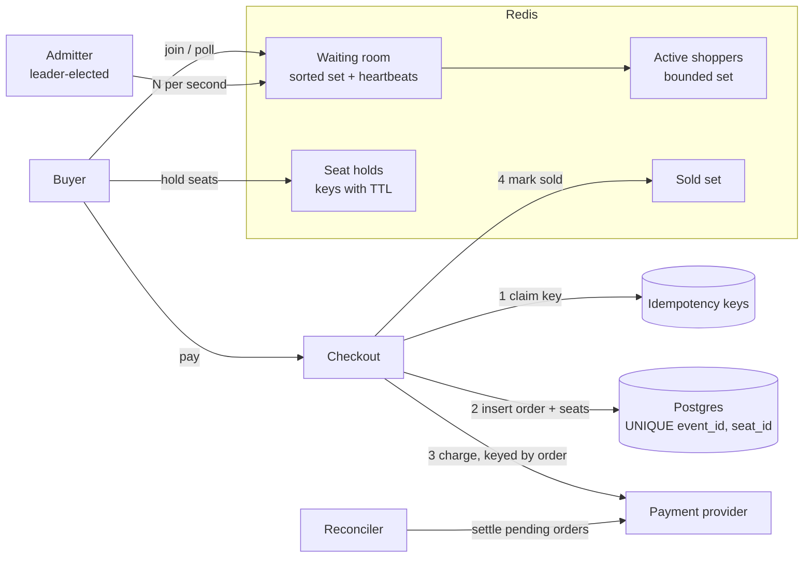
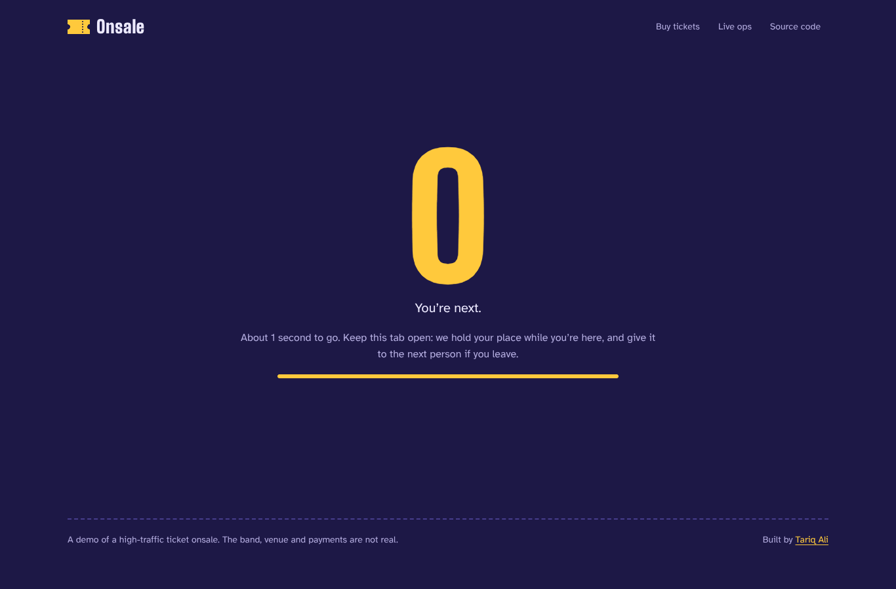
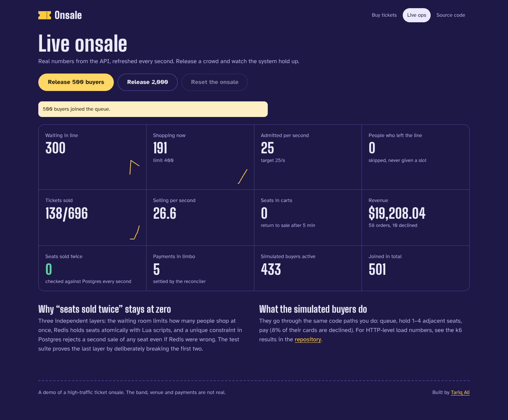

# Onsale

**A ticket onsale engine built for the moment 2,000 people want the same 700 seats.**

A virtual waiting room, all-or-nothing seat holds and idempotent checkout, with a
database guarantee that no seat is ever sold twice. Load-tested with k6 and audited
against Postgres after every run.

[](https://github.com/Tariqali13/onsale/actions/workflows/ci.yml)


<p align="center">
  
</p>

## Why this exists

I spent several years on a large event-ticketing platform, where an onsale can mean
thousands of tickets gone in minutes while thousands more people wait in a queue. That
work is in private repositories, so this project rebuilds the core problems from
scratch, in the open, with the trade-offs written down:

- **Fairness under a thundering herd.** Everyone arrives at 10:00:00. Who gets in first,
  and how do you protect the rest of the system while they wait?
- **Inventory correctness.** Two people click the same seat in the same millisecond.
  Exactly one gets it, and a group booking gets all of its seats or none of them.
- **Money correctness.** A buyer double-clicks Pay, or their train enters a tunnel
  mid-request. They are charged once, and the system still knows what happened.

## Results

From [`load/`](load/README.md): 2,000 simulated buyers, 696 seats, one API process on a
2 vCPU machine shared with Postgres, Redis and the load generator itself.

| | |
| --- | --- |
| Seats sold | **696 / 696** in ~20 s |
| Seats sold more than once | **0** (audited in Postgres after the run) |
| Unexpected errors | **0** of 24,251 requests |
| Seat hold, median / p95 | 8 ms / 168 ms |
| Checkout incl. simulated payment, median / p95 | 173 ms / 327 ms |
| Buyers told "sold out" instead of waiting forever | 1,418 |

CI repeats a smaller version of this test on every push and fails the build if the
audit finds a single double-sold seat.

## How it works



**1. Waiting room.** Buyers join a Redis sorted set scored by arrival time. A single
admitter (elected with a Redis lock, so any number of API instances can run) moves up to
`ADMIT_RATE_PER_SEC` buyers per second into a bounded active set. Everything downstream
is sized for `MAX_ACTIVE_SESSIONS`, not for total demand. Polling doubles as a
heartbeat: people who close the tab are skipped rather than admitted, and an admitted
buyer who never picks up their pass loses the slot after 30 seconds.

**2. Seat holds.** A Lua script checks every requested seat and takes all of them, or
none, in one atomic step. Holds are keys with a TTL, so abandoned carts release
themselves with no cleanup job. All keys for an event share a `{eventId}` hash tag, so
the scripts stay valid on Redis Cluster.

**3. Checkout.** Ordered so that money and inventory can't disagree:

1. Claim the `Idempotency-Key`. A retry with the same key replays the stored response.
2. Verify the holds and extend them so they can't expire mid-payment.
3. Insert the order and its seats. `UNIQUE (event_id, seat_id)` is the last line of
   defence: even if Redis were wrong, Postgres rejects a second sale.
4. Charge, using the order id as the provider's idempotency key.
5. Mark the order paid (seats become sold) or failed (the buyer keeps their hold and
   can try another card).

If the process dies between 3 and 5, a **reconciler** asks the payment provider what
actually happened and converges the order, and the client's retried request then
replays the settled result.

**4. Seat map at scale.** The catalog (section, row, number, price) never changes during
an onsale, so it is served once with cache headers. Live state is a separate string with
one character per seat (`a`, `h`, `s`), built from a shared 250 ms snapshot. Redis load
stays flat no matter how many people are looking at the map.

More detail, including what I'd change for a real deployment, is in
[docs/ARCHITECTURE.md](docs/ARCHITECTURE.md). Key decisions are recorded as
[ADRs](docs/adr).

## Proving it

The integration tests run against real Postgres and Redis, because mocks would hide
exactly the behaviour worth testing:

- 300 concurrent buyers fighting over 40 seats: every seat sold exactly once.
- 200 concurrent hold attempts on the same pair of seats: exactly one succeeds.
- **Redis deliberately broken** so every hold check passes: 20 concurrent checkouts for
  one seat produce one sale and 19 clean `409`s from the database constraint.
- A payment that succeeds but whose response is lost: the order stays `pending`,
  retries get `409` instead of a second charge, the reconciler settles it, and the
  retry then replays `201`.
- Waiting-room fairness, capacity limits, ghost skipping, claim windows, and that only
  one of three competing admitters ever admits.

```bash
npm test          # 37 API integration tests + 5 web unit tests
```

## Try it

**Live demo: [onsalerender.netlify.app](https://onsalerender.netlify.app)** (free tier: the first
visit after a quiet spell takes ~30 s while the API wakes up). Deployment notes are in
[DEPLOY.md](DEPLOY.md).

Open the **Live ops** page, release 500 simulated buyers, then join the queue yourself
and compete with them for seats. The test cards cover a decline and a slow network, so
you can double-click Pay and watch it charge once.

| | |
| --- | --- |
|  |  |

### Run locally

Needs Node 22+, Postgres and Redis. The quickest way to get both is Docker:

```bash
docker compose up -d postgres redis
npm install
npm run dev              # API on :4000 (OpenAPI docs at /docs), web on :5173
```

**Using your own Postgres and Redis instead** (e.g. Postgres.app and
`brew install redis && brew services start redis` on macOS): copy `.env.example` to
`.env` and set `DATABASE_URL` to your own username and password. The API reads `.env`
from the repo root or `apps/api/`, creates the database if it doesn't exist yet, and if
Postgres or Redis can't be reached it says which one and how to fix it.

`npm test` uses a separate `onsale_test` database and Redis db 15; override them with
`TEST_DATABASE_URL` and `TEST_REDIS_URL`.

Add Prometheus and a pre-built Grafana dashboard with
`docker compose --profile observability up`.

## Stack

| | |
| --- | --- |
| API | Node.js 22, TypeScript (strict), Fastify 5, Zod, OpenAPI |
| Data | PostgreSQL 16, Redis 7 (Lua scripts) |
| Payments | Provider interface with a deterministic mock and Stripe PaymentIntents (test mode only) |
| Web | React 19, TanStack Query, hand-rolled SVG seat map, no UI kit |
| Quality | Vitest against real services, k6, GitHub Actions, Prometheus metrics, Grafana |
| Deploy | Docker, Render (API), Vercel or Netlify (web), Neon, Upstash |

## Project layout

```
apps/api/src
  queue/       waiting room, admitter (leader election), access passes
  holds/       atomic seat holds (Lua)
  checkout/    checkout flow, idempotency, pricing, reconciler
  payments/    provider interface, mock and Stripe implementations
  events/      catalog, seat-map snapshot cache, demo reset
  sim/         crowd simulator for the live demo
apps/web/src   React client
load/          k6 scenario and recorded results
docs/          architecture notes and ADRs
infra/         Prometheus and Grafana provisioning
```

---

Built by [Tariq Ali](https://tariqali.dev). The band, venue and payments are fictional.
